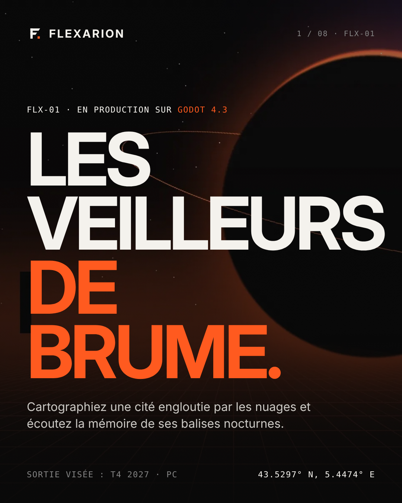
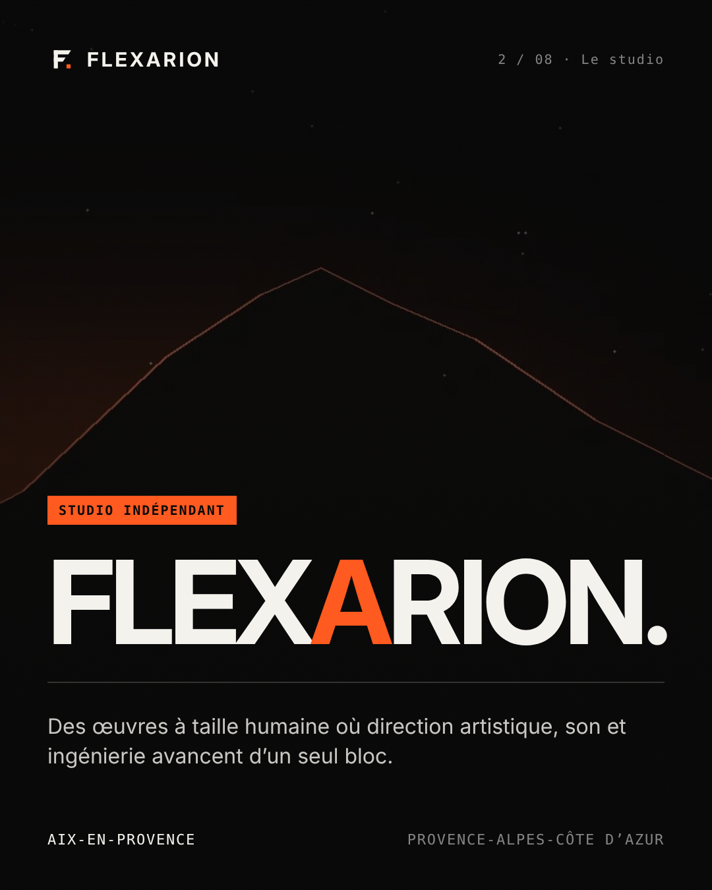
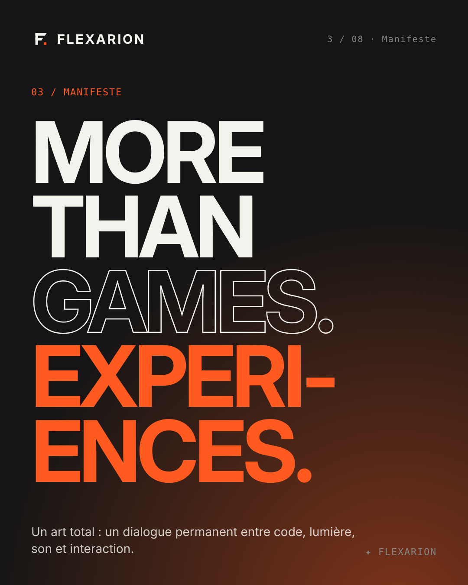
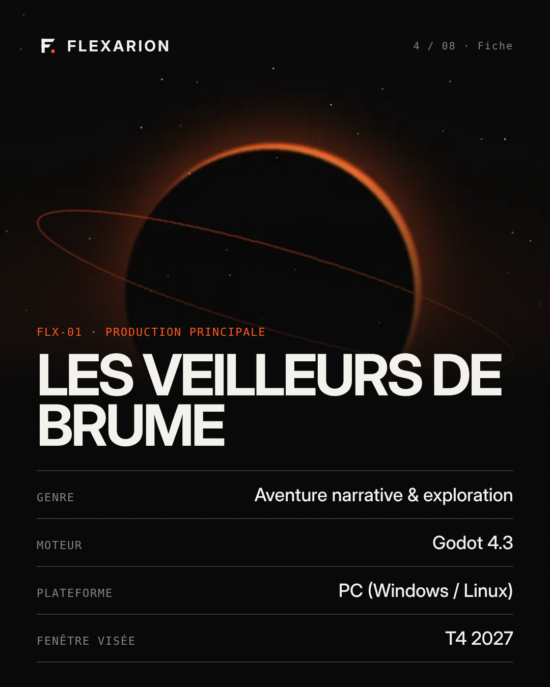
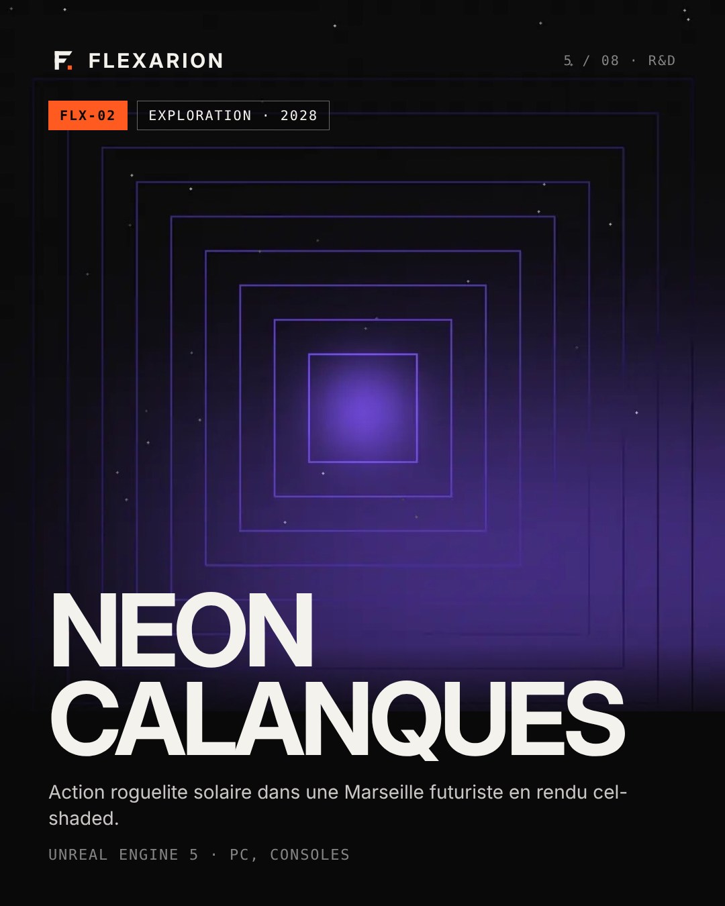
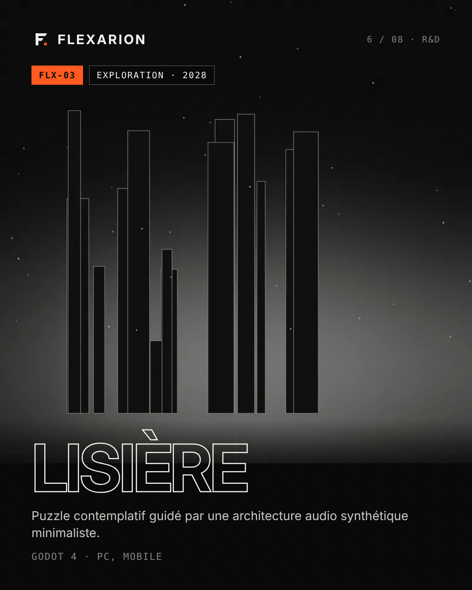
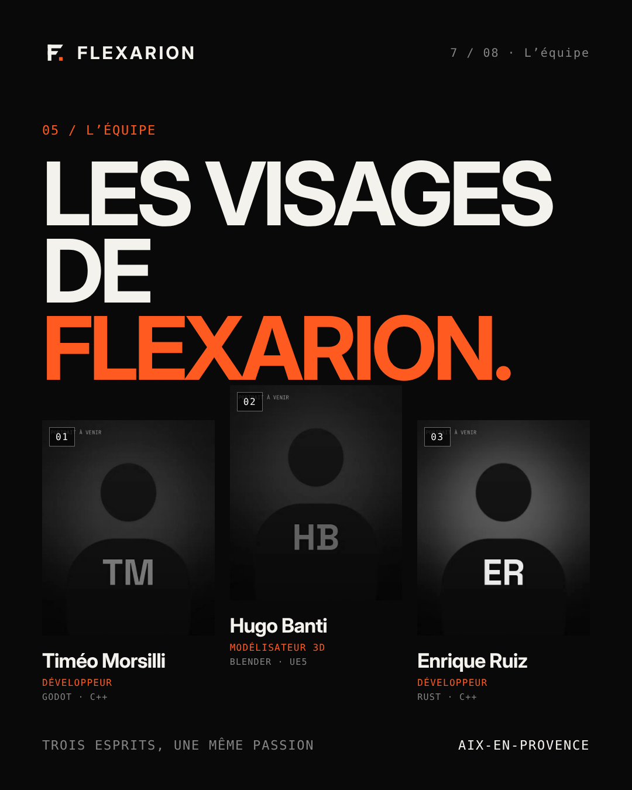
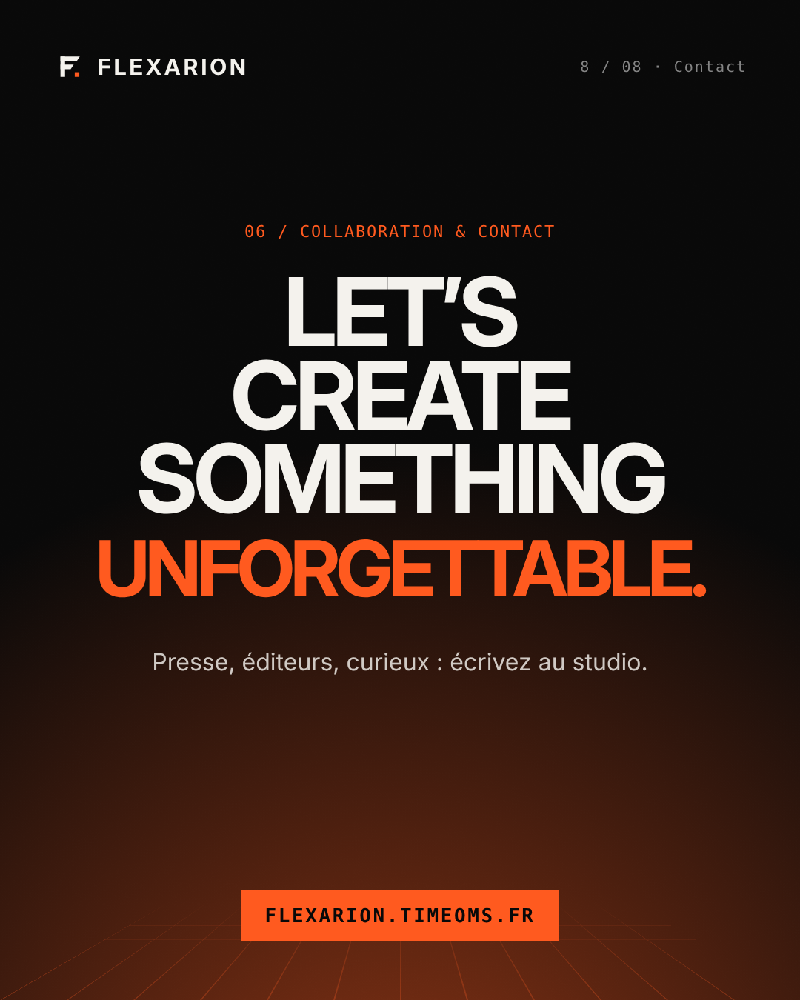

# Légendes Instagram — Flexarion

Lien en bio : flexarion.timeoms.fr

## Post 1 — Les Veilleurs de Brume

Dans une cité suspendue au-dessus d'un océan de brume, Nara cartographie les signaux des anciens phares. 🌫️
Les Veilleurs de Brume, notre aventure narrative, est en production sur Godot 4.3. Sortie visée : T4 2027 sur PC.
#LesVeilleursDeBrume #Godot #IndieGame #GameDev #AventureNarrative #Flexarion

## Post 2 — Le studio

Flexarion, studio indépendant de jeux vidéo basé à Aix-en-Provence. 📍
Des œuvres à taille humaine où direction artistique, son et ingénierie avancent d'un seul bloc.
#IndieDev #StudioIndépendant #AixEnProvence #JeuVidéo #Flexarion

## Post 3 — Manifeste

More than games. Experiences. ✦
Nous croyons au jeu vidéo comme un art total : un dialogue permanent entre code, lumière, son et interaction.
#GameDesign #IndieGames #Flexarion #GameArt

## Post 4 — Fiche FLX-01

Les Veilleurs de Brume en un coup d'œil : aventure narrative & exploration, Godot 4.3 (shaders volumétriques maison), PC Windows / Linux, fenêtre visée T4 2027.
Le devlog technique est sur notre site (lien en bio).
#Devlog #Godot4 #IndieGame #GameDev #Flexarion

## Post 5 — Neon Calanques (FLX-02)

Dans nos labos : Neon Calanques, un action roguelite solaire dans une Marseille futuriste en cel-shading sous Unreal Engine 5. Exploration en cours, vision 2028. ⚡
#NeonCalanques #UnrealEngine5 #Roguelite #CelShading #Flexarion

## Post 6 — Lisière (FLX-03)

Lisière : un puzzle contemplatif guidé par une architecture audio synthétique minimaliste. Prototype sur Godot 4, PC et mobile. 🎧
#Lisière #PuzzleGame #GameAudio #Godot #Flexarion

## Post 7 — L'équipe

Trois esprits, une même passion : Timéo (développeur), Hugo (modélisateur 3D) et Enrique (développeur). 👋
#TeamIndie #GameDev #Flexarion

## Post 8 — Contact

Presse, éditeurs, curieux : écrivez-nous ! Contact et espace presse sur flexarion.timeoms.fr (lien en bio).
#IndieStudio #GameDev #Flexarion
